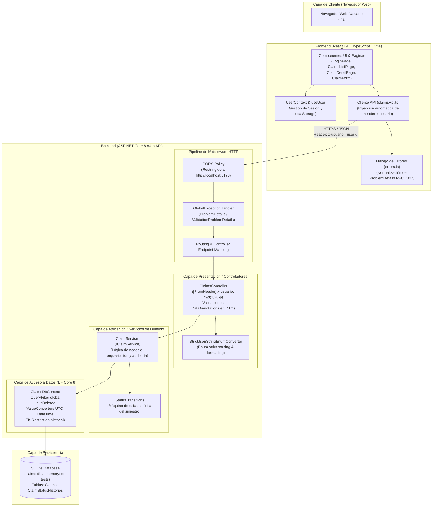
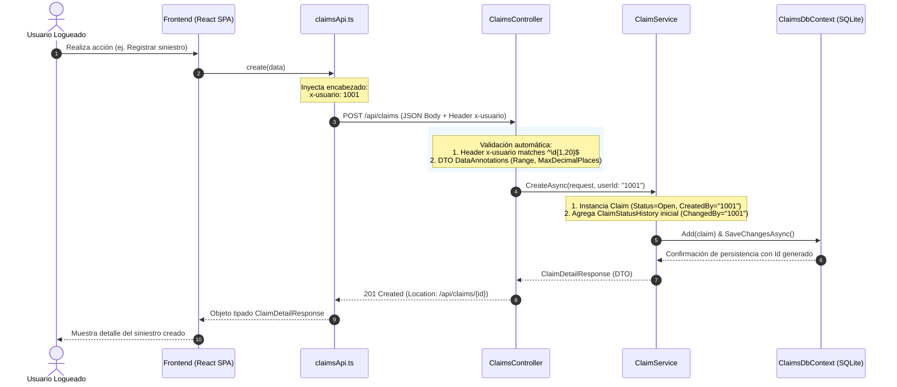

# Arquitectura del Sistema — Gestor de Siniestros (Zurich Claims)

Este documento describe la arquitectura técnica, la distribución en capas y los flujos de comunicación entre los componentes del sistema desarrollado para la prueba técnica de Zurich Insurance Company (ZCC).

---

## 1. Diagrama de Arquitectura Global (C4 - Contenedores y Capas)

---

## 2. Descripción de Componentes y Responsabilidades

### 2.1 Capa Frontend (Single Page Application)
- **Vite + React 19 + TypeScript:** Aplicación cliente de alto rendimiento sin librerías externas de UI (CSS nativo y estilos en línea).
- **UserContext (`useUser`):** Administra la identidad del usuario logueado en la sesión. Se almacena en `localStorage` y valida que el identificador sea numérico entero $> 0$.
- **Cliente API Centralizado (`claimsApi.ts`):** Punto único de salida de peticiones HTTP con `fetch`. Extrae el `userId` activo y lo inyecta como encabezado `x-usuario` en cada solicitud (`GET`, `POST`, `PUT`, `DELETE`).
- **Mapeo de Errores (`ApiError`):** Parsea respuestas `ProblemDetails` y `ValidationProblemDetails`, abstrayendo la interfaz de usuario de mensajes genéricos.

### 2.2 Capa Backend (ASP.NET Core Web API)
- **Controlador REST (`ClaimsController`):**
  - Expone los endpoints REST para el ciclo de vida del siniestro.
  - Exige y valida el encabezado `[FromHeader(Name = "x-usuario")]` con expresión regular `^\d{1,20}$`.
  - Valida contratos de entrada mediante DTOs fuertemente tipados (`CreateClaimRequest`, `UpdateClaimRequest`, `ChangeStatusRequest`).
- **Conversor Estricto de Enums (`StrictJsonStringEnumConverter`):**
  - Deserializa y serializa estados (`ClaimStatus`) exclusivamente en formato texto (`"Open"`, `"InReview"`, `"Closed"`).
  - Rechaza números literales (ej. `0`, `1`, `99`) o cadenas numéricas (`"1"`).
- **Servicio de Dominio (`ClaimService`):**
  - Ejecuta las reglas de negocio de creación, actualización, cambio de estado y borrado lógico.
  - Aplica ventanas de tiempo para auditoría (`CreatedAt`, `UpdatedAt`, `DeletedAt`).
  - Consulta la máquina de estados `StatusTransitions.IsValid(origen, destino)`.
  - Escapa caracteres comodín (`\`, `%`, `_`) en búsquedas `LIKE` sobre el número de póliza.
- **Contexto de Base de Datos (`ClaimsDbContext`):**
  - Filtro global de borrado lógico: `entity.HasQueryFilter(c => !c.IsDeleted)`.
  - Restricción de integridad referencial: `OnDelete(DeleteBehavior.Restrict)` para impedir el borrado físico de siniestros con historial.
  - `ValueConverter` bidireccional para garantizar que todas las fechas recuperadas de SQLite mantengan `DateTimeKind.Utc`.

---

## 3. Diagrama de Secuencia de una Petición Típica (Auditoría con `x-usuario`)

