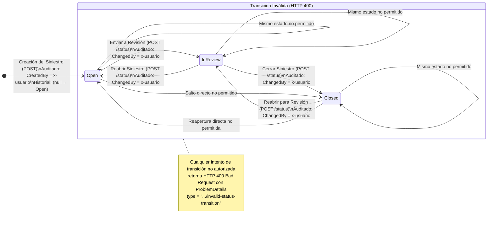
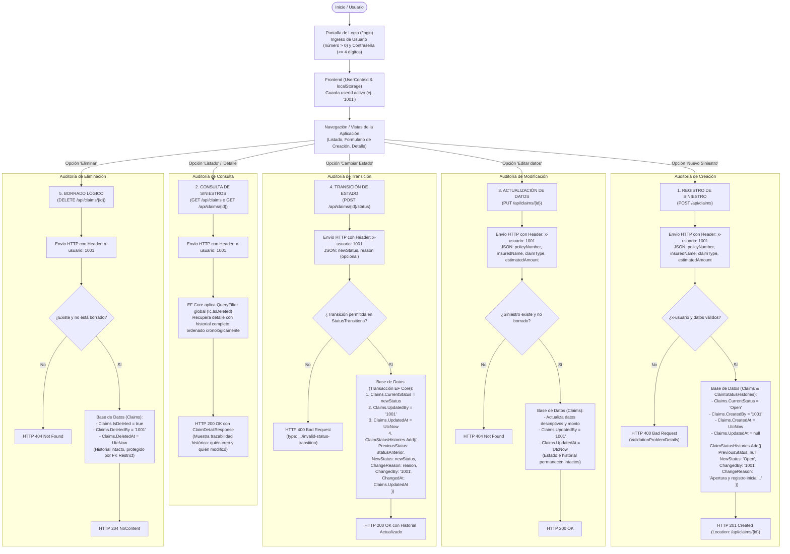

# Ciclo de Vida y Flujo de Auditoría de Siniestros (Claims Lifecycle)

Este documento detalla el ciclo de vida del siniestro, las transiciones de estado permitidas y cómo se registra y audita el **número de usuario logueado (`x-usuario`)** en cada una de las interacciones dentro del sistema.

---

## 1. Máquina de Estados Finita del Siniestro

El sistema implementa una máquina de estados controlada por [`StatusTransitions.cs`](file:///c:/Proyectos/Zurich/ZCC/PruebaTecnica/backend/ZurichClaims.Api/Services/StatusTransitions.cs), evitando saltos arbitrarios entre estados:

---

## 2. Diagrama de Flujo Completo: Interacciones y Registro del Usuario Logueado

El siguiente diagrama ilustra el flujo de extremo a extremo, mostrando cómo el identificador numérico del usuario logueado (`x-usuario`) es capturado en el cliente y propagado hacia la base de datos para garantizar la trazabilidad de auditoría en todas las operaciones:

---

## 3. Matriz de Auditoría por Operación

La siguiente tabla resume qué campos de auditoría se actualizan en la base de datos en cada interacción y cómo se vincula el usuario de la sesión:

| Operación | Endpoint HTTP | Header Requerido | Campos Auditados en `Claims` | Registros Auditados en `ClaimStatusHistories` |
|---|---|---|---|---|
| **Creación** | `POST /api/claims` | `x-usuario: {id}` | `CreatedBy = {id}` `CreatedAt = UtcNow` `UpdatedAt = null` `UpdatedBy = null` | Inserta fila inicial: `PreviousStatus = null` `NewStatus = Open` `ChangedBy = {id}` `ChangedAt = CreatedAt` |
| **Edición de Datos** | `PUT /api/claims/{id}` | `x-usuario: {id}` | `UpdatedBy = {id}` `UpdatedAt = UtcNow` *(Datos modificados)* | *(No genera fila de historial; solo actualiza auditoría de entidad)* |
| **Cambio de Estado** | `POST /api/claims/{id}/status` | `x-usuario: {id}` | `CurrentStatus = {newStatus}` `UpdatedBy = {id}` `UpdatedAt = UtcNow` | Inserta nueva fila histórica: `PreviousStatus = {prevStatus}` `NewStatus = {newStatus}` `ChangeReason = {motivo}` `ChangedBy = {id}` `ChangedAt = UpdatedAt` |
| **Borrado Lógico** | `DELETE /api/claims/{id}` | `x-usuario: {id}` | `IsDeleted = true` `DeletedBy = {id}` `DeletedAt = UtcNow` | *(El historial histórico se preserva intacto para fines legales y de auditoría)* |
| **Consultas** | `GET /api/claims` `GET /api/claims/{id}` | `x-usuario: {id}` | *(Solo lectura; valida formato de usuario)* | *(Retorna trazabilidad histórica completa al cliente)* |

---

## 4. Garantías de Integridad y Trazabilidad

1. **Inmutabilidad del Historial:** La tabla `ClaimStatusHistories` es de solo inserción (*append-only*). Ninguna acción de la API modifica ni elimina registros de historial existentes.
2. **Protección contra Borrado Físico Cascada:** La clave foránea está configurada con `OnDelete(DeleteBehavior.Restrict)`. Si una instrucción SQL física intentara ejecutar `DELETE FROM Claims WHERE Id = X`, el motor de base de datos SQLite/SQL Server rechazará la operación por violación de restricción referencial si el siniestro posee registros de historial.
3. **Consistencia Temporal:** En los cambios de estado, la marca temporal `ChangedAt` del historial es exactamente idéntica a `UpdatedAt` del siniestro, garantizando sincronización exacta entre la entidad y su bitácora.

