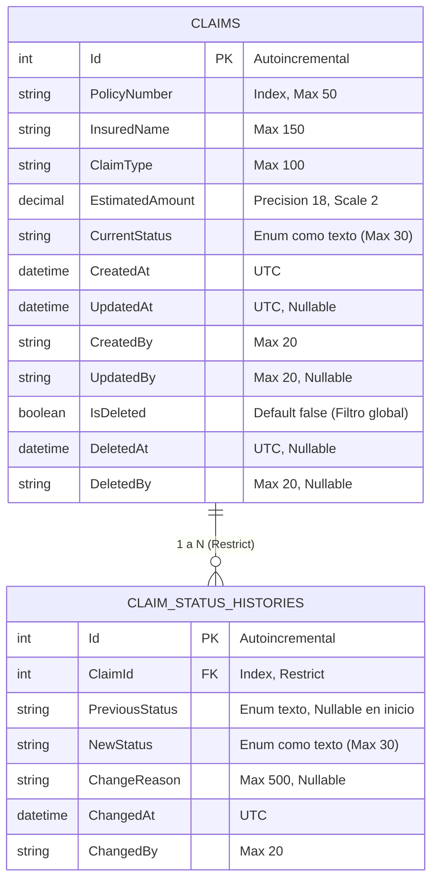

# Gestor de Siniestros Simplificado (Zurich Claims)

Prueba técnica para Zurich Insurance Company – Centro de Competencia (ZCC).  
Candidato: **Brayan Robles**

Sistema para el registro, consulta, actualización y transición de estados de siniestros, desarrollado con una API REST en **.NET 8** y una interfaz de usuario en **React** con **TypeScript**.

---

## 1. Stack Tecnológico y Versiones Reales

### Backend
- **Framework:** .NET 8.0 (C# 12) – ASP.NET Core Web API
- **ORM:** Entity Framework Core 8.0.11 (`Microsoft.EntityFrameworkCore.Sqlite`)
- **Base de Datos:** SQLite (`claims.db` en modo local, `:memory:` en pruebas)
- **Documentación OpenAPI:** Swashbuckle (`Swashbuckle.AspNetCore` 6.6.2)
- **Pruebas Automatizadas:**
  - xUnit 2.9.2
  - Visual Studio Test Runner (`xunit.runner.visualstudio` 2.8.2)
  - Microsoft .NET Test SDK (`Microsoft.NET.Test.Sdk` 17.11.1)
  - Pruebas de integración HTTP (`Microsoft.AspNetCore.Mvc.Testing` 8.0.11)

### Frontend
- **Librería UI:** React 19.3.1 y React DOM 19.3.1
- **Enrutamiento:** React Router DOM 7.18.5
- **Empaquetador y Dev Server:** Vite 8.3.5
- **Lenguaje:** TypeScript 7.0.2
- **Linter:** Oxlint 1.89.0
- **Estilos:** CSS plano nativo y estilos en línea, sin librerías de componentes externas ni frameworks CSS. Cliente HTTP nativo con `fetch` (sin Axios).

---

## 2. Requisitos de Entorno

- **.NET SDK:** Versión mínima **8.0** (probado y validado en este entorno con SDK 9.0/10.0 apuntando a target framework `net8.0`).
- **Node.js:** Versión mínima **18.x** o **20.x+** exigida por Vite 8 (probado y validado en este entorno con Node.js **v24.15.0** y npm **11.1.0**).

---

## 3. Instrucciones de Ejecución

### 3.1 Backend (API REST)
1. Navega a la raíz del repositorio o a la carpeta del backend:
   ```powershell
   dotnet run --project backend/ZurichClaims.Api
   ```
2. La API se iniciará en `http://localhost:5137` (configurado en `launchSettings.json`).
3. Accede a la documentación interactiva Swagger UI en:
   ```
   http://localhost:5137/swagger
   ```

### 3.2 Frontend (Aplicación Web)
1. Abre una nueva terminal y navega a la carpeta `frontend`:
   ```powershell
   cd frontend
   ```
2. Instala las dependencias congeladas:
   ```powershell
   npm ci
   ```
3. Copia el archivo de variables de entorno de ejemplo:
   ```powershell
   cp .env.example .env
   ```
   *(El archivo `.env` define `VITE_API_BASE_URL=http://localhost:5137`).*
4. Inicia el servidor de desarrollo:
   ```powershell
   npm run dev
   ```
5. Abre en tu navegador `http://localhost:5173`. El puerto está configurado como fijo con `strictPort: true` para coincidir con la política CORS del backend.

### 3.3 Inicio de Sesión de Demostración
La aplicación incluye una pantalla de acceso (`/login`) para capturar el identificador del usuario que opera el sistema:
- **Usuario:** Cualquier valor numérico entero $> 0$ de 1 a 20 dígitos (ej. `1001`, `2024`).
- **Contraseña:** Cualquier cadena de $\ge 4$ caracteres (valor demo sugerido: `1234`).
- El identificador queda almacenado en `localStorage` y se transmite automáticamente en el encabezado HTTP `x-usuario` en todas las peticiones a la API.

### 3.4 Ejecución de Pruebas Automatizadas
Para ejecutar la suite completa de 73 pruebas del backend (unitarias, integración con SQLite en memoria y API con `WebApplicationFactory`):
```powershell
dotnet test
```

---

## 4. Estructura del Repositorio y Modelo de Datos

```
ZurichClaims/
├── backend/
│   ├── ZurichClaims.Api/          # API REST ASP.NET Core
│   │   ├── Controllers/           # ClaimsController con endpoints REST
│   │   ├── Converters/            # StrictJsonStringEnumConverter
│   │   ├── Data/                  # ClaimsDbContext y configuraciones EF
│   │   ├── Dtos/                  # Requests, Responses y DataAnnotations
│   │   ├── Exceptions/            # ClaimNotFoundException, InvalidStatusTransitionException
│   │   ├── Migrations/            # Migraciones EF Core SQLite
│   │   ├── Models/Entities/       # Claim, ClaimStatus, ClaimStatusHistory
│   │   └── Services/              # ClaimService y máquina de estados
│   └── ZurichClaims.Api.Tests/    # Suite de pruebas xUnit
│       ├── Api/                   # Pruebas HTTP con WebApplicationFactory
│       ├── Helpers/               # TestDb y CustomWebApplicationFactory
│       ├── Integration/           # Pruebas del servicio con SQLite :memory:
│       └── Unit/                  # Pruebas unitarias puras y de cultura
├── frontend/                      # SPA React + Vite + TypeScript
│   ├── src/
│   │   ├── api/                   # Cliente tipado claimsApi y clase ApiError
│   │   ├── components/            # Header, ErrorMessage, StatusBadge
│   │   ├── context/               # UserContext para sesión de usuario
│   │   ├── pages/                 # ClaimsListPage, ClaimDetailPage, ClaimFormPage, LoginPage
│   │   ├── types.ts               # Tipos TypeScript derivados del swagger.json
│   │   └── utils/                 # Formateadores (es-MX) y validadores
│   └── .env.example               # Plantilla de variables de entorno
├── AI_LOG.md                      # Registro de prompts y decisiones asistidas por IA
├── ZurichClaims.sln               # Solución clásica .sln para compatibilidad con SDK 8
└── README.md                      # Esta documentación
```

### Modelo de Datos (Relacional)



- **Filtro global de borrado:** `Claims` tiene configurado `HasQueryFilter(c => !c.IsDeleted)`.
- **Integridad referencial estricta:** `OnDelete(DeleteBehavior.Restrict)` impide eliminar físicamente filas de `Claims` que posean historial en `ClaimStatusHistories`.

---

## 5. Endpoints de la API y Manejo de Errores

Todos los endpoints exigen el encabezado HTTP obligatorio **`x-usuario`** (validado con la expresión regular `^\d{1,20}$`).

| Método | Ruta | Códigos HTTP | Descripción |
|---|---|---|---|
| `GET` | `/api/claims` | `200`, `400`, `500` | Listado general. Filtros opcionales `?status=Open` y `?policyNumber=POL-2024`. Escapa comodines `%`, `_` y `\`. |
| `POST` | `/api/claims` | `201`, `400`, `500` | Creación de siniestro en estado `Open` con registro de historial inicial. Retorna cabecera `Location`. |
| `GET` | `/api/claims/{id}` | `200`, `400`, `404`, `500` | Consulta detallada del siniestro con su historial cronológico. |
| `PUT` | `/api/claims/{id}` | `200`, `400`, `404`, `500` | Modificación de datos descriptivos y monto sin alterar estado ni historial. |
| `POST` | `/api/claims/{id}/status` | `200`, `400`, `404`, `500` | Transición de estado (`Open -> InReview`, `InReview -> Open`, `InReview -> Closed`, `Closed -> InReview`). |
| `DELETE` | `/api/claims/{id}` | `204`, `400`, `404`, `500` | Borrado lógico (`IsDeleted = true`). El registro y su historial se preservan en BD. |

### Formato de Errores
La API implementa el estándar RFC 7807/9457 (`ProblemDetails` y `ValidationProblemDetails`):
- Falla de validación de parámetros o cuerpo: `400 Bad Request` con diccionario `errors`.
- Siniestro no encontrado o borrado: `404 Not Found` con `ProblemDetails`.
- **Transición de estado inválida:** `400 Bad Request` con `type = "https://httpstatuses.com/400/invalid-status-transition"` y detalle explicativo de la transición rechazada.

---

## 6. Decisiones de Diseño

1. **Fechas en UTC:** Todas las marcas temporales (`CreatedAt`, `UpdatedAt`, `ChangedAt`, `DeletedAt`) se almacenan y transmiten en formato UTC (`Z`). En `ClaimsDbContext` se implementaron `ValueConverter` para asegurar que SQLite devuelva siempre instancias `DateTime` con `DateTimeKind.Utc`. El frontend las formatea en la hora local del usuario (`es-MX`).
2. **Borrado lógico y FK Restrict:** Ningún siniestro es eliminado físicamente al invocar `DELETE`. Se registra `IsDeleted = true`, `DeletedAt` y `DeletedBy`. La relación foránea con `DeleteBehavior.Restrict` garantiza a nivel de base de datos que ninguna operación SQL física pueda borrar siniestros que tengan trazabilidad histórica.
3. **Estados como Enum guardado como texto:** `ClaimStatus` se persiste como `string` (`TEXT`) en la base de datos para facilitar auditorías directas en la base y evitar discrepancias de orden numérico. La deserialización JSON utiliza un conversor estricto que rechaza números sueltos o strings inválidos.
4. **Migraciones automáticas al arrancar:** En `Program.cs`, la API ejecuta `dbContext.Database.Migrate()` al iniciar. Esta decisión es intencional para garantizar que la prueba técnica sea ejecutable inmediatamente sin comandos previos de CLI, aunque en un entorno productivo real las migraciones deben ejecutarse como un paso independiente en el pipeline de despliegue.
5. **Tope de Monto Estimado:** Se fijó un tope de negocio de **$999,999,999,999.99** (mínimo $0.01) tanto en el backend (`[Range]` con `ParseLimitsInInvariantCulture = true`) como en el frontend (`validators.ts`). Esto previene pérdida de precisión por conversión a punto flotante IEEE 754 (`double`) en JavaScript y evita que `JSON.stringify` convierta montos grandes a notación exponencial (`e+28`).

---

## 7. Procedimiento para Migrar a Microsoft SQL Server

Para migrar esta aplicación a SQL Server en un entorno empresarial, **no basta con cambiar el proveedor en `Program.cs`**. Es necesario seguir con precisión los siguientes pasos:

1. **Reemplazo de paquetes NuGet en `ZurichClaims.Api.csproj`:**
   - Desinstalar `Microsoft.EntityFrameworkCore.Sqlite`.
   - Instalar `Microsoft.EntityFrameworkCore.SqlServer` versión `8.0.x`.
2. **Configuración del DbContext en `Program.cs`:**
   - Reemplazar `options.UseSqlite(...)` por:
     ```csharp
     builder.Services.AddDbContext<ClaimsDbContext>(options =>
         options.UseSqlServer(builder.Configuration.GetConnectionString("DefaultConnection")));
     ```
3. **Regeneración de migraciones desde cero:**
   - Las migraciones actuales en `backend/ZurichClaims.Api/Migrations/` contienen metadatos y tipos DDL específicos del motor SQLite:
     - Anotaciones `.Annotation("Sqlite:Autoincrement", true)` en lugar de `.Annotation("SqlServer:Identity", "1, 1")`.
     - Tipos de columna `type: "TEXT"` para `EstimatedAmount`, `CreatedAt`, etc.
   - Se debe eliminar la carpeta `Migrations/` y ejecutar:
     ```powershell
     dotnet ef migrations add InitialCreateSqlServer --project backend/ZurichClaims.Api
     ```
   - EF Core generará el DDL nativo de SQL Server: `int IDENTITY(1,1)`, `decimal(18,2)` para montos monetarios, `nvarchar(50)` para cadenas y `datetime2` para fechas.
4. **ValueConverters de Fecha:**
   - Los convertidores `DateTimeKind.Utc` en `ClaimsDbContext` pueden conservarse o sustituirse por tipos `datetimeoffset` nativos de SQL Server.

---

## 8. Limitaciones Conocidas Verificadas en el Código

1. **Autenticación real ausente:** El encabezado `x-usuario` es únicamente un identificador funcional para fines de auditoría; no existe verificación criptográfica de identidad, firma de tokens JWT ni validación de sesiones en el servidor.
2. **Login simulado:** La pantalla de login del frontend valida formato y almacena el usuario en el `localStorage` del navegador.
3. **Sin paginación en el listado:** `GetAllAsync` devuelve la totalidad de los siniestros no borrados que coincidan con los filtros, lo que en bases con miles de registros requeriría paginación (`skip`/`take`).
4. **Sin control de concurrencia optimista:** No existe una columna de versión (`RowVersion` / `byte[] Timestamp`) en la entidad `Claim`; si dos usuarios editan el mismo siniestro en paralelo, la última escritura sobrescribe a la anterior.
5. **Sin pruebas automatizadas en el Frontend:** La suite de pruebas automatizadas está concentrada en el backend (unitarias, integración y API con 73 pruebas). El frontend cuenta con verificación de tipos (`tsc -b`) y análisis estático (`oxlint`), pero no incluye pruebas unitarias ni de componentes (Jest/Vitest).
6. **Estilos en línea (inline styles):** Los estilos de los componentes en React están implementados mediante la propiedad `style={{ ... }}` nativa para mantener cero dependencias externas de librerías CSS, lo que limita la reutilización de temas centralizados.
7. **Almacenamiento de decimales como texto en SQLite:** Por diseño del proveedor SQLite de EF Core, el tipo `decimal` se almacena como `TEXT` en la base de datos. Por esta razón, el ordenamiento en base de datos se realiza por `CreatedAt DESC, Id DESC` y no directamente por `EstimatedAmount` en SQL crudo.

---

## 9. Registro de Asistencia por IA

Para consultar el registro completo de prompts, instrucciones de desarrollo y bitácora de interacción asistida por IA, consulta el archivo:
- [`AI_LOG.md`](file:///c:/Proyectos/Zurich/ZCC/PruebaTecnica/AI_LOG.md)
